# Workflow Rules

## Mandatory Development Order

```mermaid
flowchart TD
    Start["New Feature / Change"] --> Req["1a. Write requirements.md (EARS)"]
    Req --> GateReq{"User Approves?"}
    GateReq -- No --> Req
    GateReq -- Yes --> Des["1b. Write design.md (DDD + Hexagonal)"]
    Des --> GateDes{"User Approves?"}
    GateDes -- No --> Des
    GateDes -- Yes --> HasApi{"HTTP REST API?"}
    HasApi -- Yes --> OpenApi["1c. Update src/api/task-api.yaml"]
    OpenApi --> GateApi{"User Approves?"}
    GateApi -- No --> OpenApi
    GateApi -- Yes --> Tasks["1d. Write tasks.md (TDD Slices)"]
    HasApi -- No --> Tasks
    Tasks --> GateTasks{"User Approves?"}
    GateTasks -- No --> Tasks
    GateTasks -- Yes --> Plan["Explain Plan & Ask File Permission"]
    Plan --> Red["2. TDD Red: Write Failing ports.in Tests"]
    Red --> Green["3a. Generate OpenAPI Stubs & Implement Code (domain, ports, adapters)"]
    Green --> Verify{"All ports.in & ArchUnit Tests Pass?"}
    Verify -- No --> Green
    Verify -- Yes --> Refactor["3b. Refactor & Re-verify"]
    Refactor --> CheckOff["Mark Task Complete in tasks.md"]
    CheckOff --> More{"More Tasks?"}
    More -- Yes --> Plan
    More -- No --> Done["Feature Complete"]
```

Every feature or behavioral change follows this strict 3-step sequence:

1. **Spec first**
   - Create and obtain explicit user approval for the Kiro spec artifacts (`requirements.md` -> `design.md` -> `tasks.md`) under `.kiro/specs/<capability-name>/` (see `.agents/rules/sdd.md`).
   - When the capability includes an HTTP REST API, specify/update `src/api/task-api.yaml` (contract-first, see `.agents/rules/openapi.md`) and obtain user approval before `tasks.md` and code.
   - Never write tests or production code before the spec is approved.

2. **TDD (Red)**
   - Write failing behavioral tests exclusively against `ports.in` mapped 1-to-1 to the approved EARS acceptance criteria (see `.agents/rules/testing.md`).
   - Confirm the tests define the expected behavior before writing production logic.

3. **Implement & Refactor (Green -> Refactor)**
   - When an HTTP REST API is involved, generate server stub interfaces into `build/generated/openapi/src/main/java` and implement them in `adapters.in.rest` delegating to `ports.in` (see `.agents/rules/openapi.md`).
   - Write the minimal production code following `.agents/rules/ddd.md`, `.agents/rules/architecture.md`, and `.agents/rules/java-gradle.md` until all `ports.in` tests and ArchUnit rules pass.
   - Refactor for clarity while keeping all tests green, then mark the task complete (`- [x]`) in `tasks.md`.

## Collaboration & Change Control

1. **Always explain your plan and get permission before any file change**
   - Before creating, modifying, or deleting any file, present a concise plan listing the exact affected file(s) and the intent of each change.
   - Always wait for explicit user permission before applying any file change (see `.agents/rules/safety.md`).

2. **Never add or upgrade dependencies without asking**
   - Do not add, remove, or change versions of any Gradle plugins or library dependencies without first explaining why the dependency is needed and receiving explicit approval from the user.

3. **Strict scope — do not expand or invent**
   - Do strictly what the user asks and nothing more.
   - Never imagine, assume, or add extra requirements, features, or unsolicited details.
   - If you want to suggest adding anything, ask for permission first.
   - Keep specs, files, and responses concise.
