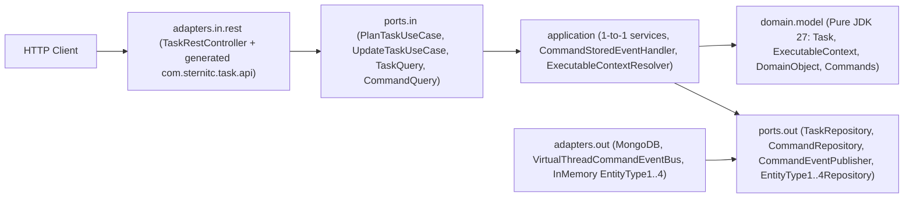
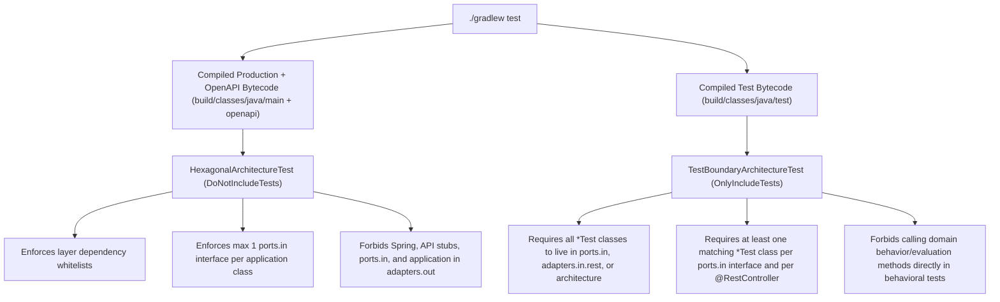

# Task Executable (`com.sternitc.task`)

A **Domain-Driven Design (DDD)** and **Hexagonal Architecture (Ports & Adapters)** service in **Java 27** and **Gradle** for planning, updating, querying, and evaluating the executability of tasks.

- **Spec-Driven**: Capabilities and acceptance criteria are maintained under `.kiro/specs/` (EARS requirements, DDD design, TDD tasks, shared glossary).
- **Contract-First REST**: OpenAPI 3 specification in `src/api/task-api.yaml` generates Spring server interfaces and DTOs outside `./src` (`build/generated/openapi`).
- **Command-First Async Processing**: All mutating commands are validated, persisted first, and processed asynchronously on Java 27 Virtual Threads.
- **Strictly Enforced Boundaries**: All architectural and testing rules are verified automatically by ArchUnit on every build.

---

## Hexagonal Architecture



| Package | Role | Allowed Dependencies |
| :--- | :--- | :--- |
| `com.sternitc.task.domain.model` | Aggregates (`Task`, `StoredCommand`), Value Objects, `Executable`, `ExecutableContext`, `DomainObject` (`EntityType1`–`EntityType4`), Domain Events & Exceptions | `domain.model`, JDK only (zero I/O) |
| `com.sternitc.task.domain.services` | Stateless domain logic spanning multiple aggregates | `domain.model`, `domain.services`, JDK only |
| `com.sternitc.task.ports.in` | Driving use-case and query interfaces, command/query records | `domain.model`, JDK only |
| `com.sternitc.task.ports.out` | Driven repository, ID generator, and event publisher SPIs | `domain.model`, JDK only |
| `com.sternitc.task.application` | Thin orchestration (1 implementation class per `ports.in` interface; zero business rules) | `domain.*`, `ports.*`, `application`, JDK only |
| `com.sternitc.task.adapters.in` | Driving REST adapter implementing generated `com.sternitc.task.api` stubs | `ports.in`, `domain.model`, `com.sternitc.task.api.*`, Spring Web |
| `com.sternitc.task.adapters.out` | Driven adapters (MongoDB persistence, Virtual Thread event bus, in-memory entity repositories) | `ports.out`, `domain.model`, driver libs (no Spring, no `api`, no `ports.in`) |

---

## Core Flows

### 1. Command-First Pipeline (`POST /tasks`, `PUT /tasks/{taskId}`)
1. **Validate**: Input is validated using domain rules (`domain.model`) before anything is stored; invalid commands are rejected immediately (`400 Bad Request` with uniform `ErrorResponsePayload`).
2. **Persist Command**: Valid commands are persisted as `StoredCommand` with a unique `CommandId` and timestamp.
3. **Publish & Return `202 Accepted`**: A `CommandStoredEvent` is published and the caller receives a `CommandReceipt` (`commandId`, `timestamp`).
4. **Execute Asynchronously**: `VirtualThreadCommandEventBus` dispatches the event to `CommandStoredEventHandler`, which applies the command to the `Task` aggregate, persists the `Task`, and marks the `StoredCommand` as `COMPLETED` or `FAILED`.

### 2. Queries & Task Executability (`GET /tasks`, `TaskQuery`)
1. `TaskQueryService` retrieves the requested page (`pageNumber` default `0`, `pageSize` default `20`) from `TaskRepository`.
2. For each `Task`, `ExecutableContextResolver` checks the list of `ExecutableContext` providers configured for `task.type()`:
   - **No providers (or empty list)**: Skips loading linked entities and uses `DefaultExecutableContext` (returns `true`).
   - **One or more providers**: Loads each `LinkedEntity` via its typed outbound port (`EntityType1Repository`–`EntityType4Repository`) into `LoadedDomainObjects` (missing entities are omitted without failing the query), invokes all providers, and evaluates all predicates via `task.isExecutable(...)`.
3. Only tasks for which all predicates evaluate to `true` are returned.

---

## Testing & ArchUnit Enforcement

Behavioral tests target only inbound boundaries (zero isolated unit tests, zero Mockito):
- **Inbound Ports (`src/test/java/com/sternitc/task/ports/in/`)**: At least one dedicated test class per `ports.in` interface (`PlanTaskUseCaseTest`, `UpdateTaskUseCaseTest`, `TaskQueryTest`, `CommandQueryTest`) extending `InboundPortTestSupport` against a shared **Testcontainers MongoDB** instance (with a fresh isolated database per test).
- **HTTP APIs (`src/test/java/com/sternitc/task/adapters/in/rest/`)**: Every HTTP REST API controller has a dedicated **REST Assured** API test (`TaskRestControllerTest`) running against embedded Tomcat, the real application/domain layers, typed `VirtualThreadCommandEventBus<T>` instances, and **Testcontainers MongoDB**.

Every `./gradlew test` run also executes two ArchUnit suites that inspect the compiled Java 27 bytecode:



| ArchUnit Suite | Scope | What It Prevents |
| :--- | :--- | :--- |
| `HexagonalArchitectureTest` | Production & generated OpenAPI classes (`DoNotIncludeTests`) | Layer boundary leaks, framework imports in `domain`/`ports`/`application`/`adapters.out`, combining multiple `ports.in` interfaces into one application class |
| `TestBoundaryArchitectureTest` | Test classes, nested classes & lambdas (`OnlyIncludeTests`) | Adding isolated unit tests outside `ports.in`/`adapters.in.rest`/`architecture`, omitting a dedicated test class for any `ports.in` interface or `@RestController`, or bypassing inbound boundaries by calling domain methods directly (`Task.{plan,reconstitute,restore,update,isExecutable}`, `Executable.isExecutable`, `ExecutableContext.evaluate`, `StoredCommand.{accepted,reconstitute,markCompleted,markFailed}`, `TaskSearchCriteria.matches`) |

Read-only getters and value-object constructors (e.g., `task.status()`, `new PlanningWindow(...)`) remain permitted in `ports.in` tests to construct inputs and assert outputs. When adding new domain aggregates or behavior methods, register them in `FORBIDDEN_DOMAIN_METHODS` in `src/test/java/com/sternitc/task/architecture/TestBoundaryArchitectureTest.java`.

---

## Build, Run & Test

**Prerequisites**: Java 27 (configured via Gradle toolchain) and Docker (for Testcontainers / local MongoDB).

```bash
# Run all ports.in tests, REST Assured HTTP API tests, and ArchUnit checks
./gradlew test

# Clean, regenerate OpenAPI server stubs, compile (-Xlint:all -Werror), and run all tests
./gradlew clean openApiGenerate test

# Run full stack (MongoDB + Spring Boot app on http://localhost:8080) via Docker Compose
docker compose up --build

# Or start only MongoDB in Docker and run the app locally via Gradle
docker compose up mongo
./gradlew bootRun

# Build executable Spring Boot JAR
./gradlew bootJar
```
